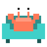
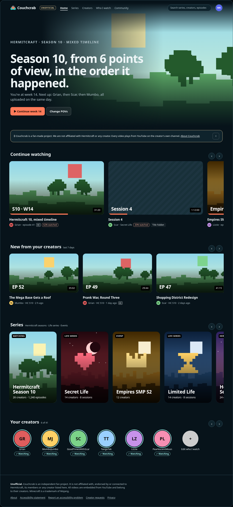

<p align="center">
  
</p>

<h1 align="center">Couchcrab</h1>

<p align="center">
  <strong>Binge Minecraft YouTube series from every point of view, in the order it happened.</strong><br>
  A community-run, open-source fan project.
</p>

<p align="center">
  <a href="LICENSE"></a>
  
  <a href="CONTRIBUTING.md"></a>
</p>

> [!IMPORTANT]
> **Couchcrab is an unofficial fan project.** It is not affiliated with, endorsed by or connected to Hermitcraft, its members, any creator listed on the site, Mojang or Microsoft. Every video plays from YouTube on the creator's own channel, so views, ads and revenue stay with the creator. Couchcrab never downloads, re-hosts or monetises videos.



## What is Couchcrab?

Multiplayer Minecraft series like a Hermitcraft season or a Life series are told by a dozen creators at once, each on their own channel. Following the story means juggling channels, playlists and upload dates. Couchcrab puts it all in one place, Netflix-style:

- **Series, not channels.** Every season, Life series and event is a series with its own poster, page and timeline.
- **Pick who you watch.** Choose your creators once. Each series can follow that list or use its own.
- **Mixed timeline.** Watch your chosen points of view (POVs) in upload order, week by week, or session by session for live series.
- **Continue watching.** Progress is saved, the next episode on your timeline plays when you're ready.
- **Spoiler-free mode.** Per series: titles and thumbnails of unwatched episodes stay hidden.
- **Extras.** Livestream VODs live in a side series next to the main one.
- **Community-maintained.** Creators, channels, series, sessions and the rules that sort uploads are all managed in the app. Anyone can suggest an edit, editors review them, everything has a history and can be reverted. Creators can file a request that always goes to the top of the queue.
- **Works without an account.** Preferences and progress live in your browser. Sign in with Discord to sync them and to suggest edits.

## Accessibility

Accessibility is a requirement, not a nice-to-have. We target **WCAG 2.2 level AA** in every theme.

- Dark, light and high-contrast themes, text size settings, reduced motion, underlined links, text-only lists.
- A **CC badge** for episodes with creator-made captions (not just auto-generated ones), and a filter to show only those.
- Autoplay is a setting with a countdown you can pause, cancel or turn into "wait for me".
- Full keyboard support, visible focus, skip links, single-key shortcuts that can be turned off.
- State is never shown by colour alone.

Every pull request that touches the UI is checked with axe and keyboard tests. See [docs/ACCESSIBILITY.md](docs/ACCESSIBILITY.md).

## Translations

Couchcrab is built to be translated. Every interface string lives in a message file, dates and numbers use the visitor's locale, and community content (series descriptions, site pages) can be translated in the app. English is the source language. Want Couchcrab in your language? See [Translating](CONTRIBUTING.md#translating).

## Status

Couchcrab is in **early development**. The designs are done (see [docs/design](docs/design)), the code is being built now. Follow the [issues](https://github.com/kzenmatthias/couchcrab/issues) to see what's next.

## Tech stack

| Part | Choice |
| --- | --- |
| App | [SvelteKit](https://svelte.dev/docs/kit) (Svelte 5, TypeScript) |
| Database | SQLite with [Drizzle ORM](https://orm.drizzle.team) |
| Translations | [Paraglide JS](https://inlang.com/m/gerre34r/library-inlang-paraglideJs) |
| Login | Discord OAuth (viewers and editors), Google OAuth (creators), server-side sessions |
| Video data | YouTube Data API v3, playback through the YouTube IFrame Player |
| Tests | Vitest, Playwright with axe-core |

## Getting started

You need **Node.js 22** or newer.

```bash
git clone https://github.com/kzenmatthias/couchcrab.git
cd couchcrab
npm install
cp .env.example .env
npm run db:migrate
npm run db:seed      # demo data, no API keys needed
npm run dev
```

Open http://localhost:5173. The demo data lets you work on the whole app without a YouTube or Discord key.

### Optional keys

Everything works without keys: the sign-in buttons are then disabled with a short explanation, and the demo data needs no API. Put keys in `.env` (never commit it).

| Variable | What for |
| --- | --- |
| `YOUTUBE_API_KEY` | Syncing real uploads (`npm run sync`). Free key from the [Google Cloud console](https://console.cloud.google.com/apis/library/youtube.googleapis.com). |
| `DISCORD_CLIENT_ID`, `DISCORD_CLIENT_SECRET` | Sign in with Discord (viewers and editors). |
| `GOOGLE_CLIENT_ID`, `GOOGLE_CLIENT_SECRET` | Creators claim their profile by signing in with Google. |
| `ADMIN_DISCORD_IDS` | Comma-separated Discord user ids that get the admin role on every sign-in. |

Redirect URLs (use your own origin in production, e.g. `https://couchcrab.example`):

| Provider | Redirect URL |
| --- | --- |
| Discord | `http://localhost:5173/auth/discord/callback` |
| Google | `http://localhost:5173/auth/google/callback` |

**Discord app**

1. Open the [Discord developer portal](https://discord.com/developers/applications) and create a new application.
2. Under **OAuth2**, copy the **Client ID** and reset/copy the **Client Secret** into `DISCORD_CLIENT_ID` and `DISCORD_CLIENT_SECRET`.
3. Add the redirect URL above under **Redirects** and save. Couchcrab only asks for the `identify` scope.
4. To make yourself admin, turn on Developer Mode in Discord, right-click your name, **Copy User ID**, and put it in `ADMIN_DISCORD_IDS`.

**Google OAuth client**

1. In the [Google Cloud console](https://console.cloud.google.com/), create (or pick) a project and enable the **YouTube Data API v3**.
2. Under **Google Auth Platform** (OAuth consent screen), set up an **External** app in **Testing** mode. Add the scopes `openid` and `https://www.googleapis.com/auth/youtube.readonly`.
3. Add the Google accounts you test with under **Test users**. Only those accounts can sign in while the app is in testing. `youtube.readonly` is a sensitive scope, so a public deployment needs Google's OAuth verification.
4. Under **Clients** (Credentials), create an **OAuth client ID** of type **Web application** and add the redirect URL above under **Authorized redirect URIs**.
5. Copy the client id and secret into `GOOGLE_CLIENT_ID` and `GOOGLE_CLIENT_SECRET`.

Couchcrab uses the Google access token once, to ask YouTube which channels the account owns (`channels.list?mine=true`), and then drops it. It keeps the Google account id and the ids and names of claimed channels, never the token.

### Useful commands

| Command | Does |
| --- | --- |
| `npm run dev` | Development server |
| `npm run check` | Type and Svelte checks |
| `npm run lint` / `npm run format` | ESLint and Prettier |
| `npm test` | Unit tests |
| `npm run test:e2e` | Browser tests, including accessibility checks |
| `npm run db:migrate` / `npm run db:seed` | Database setup and demo data |
| `npm run sync` | Fetch new uploads from YouTube, sort them with the title rules and refresh stored data older than 25 days. Flags (after `--`): `--channel <youtube id>`, `--dry-run`, `--refresh-only`. Needs `YOUTUBE_API_KEY`; without it, it exits with a note |

## Documentation

- [docs/SPEC.md](docs/SPEC.md): what Couchcrab does and the decisions behind it
- [docs/ARCHITECTURE.md](docs/ARCHITECTURE.md): data model, sync, auth, translations
- [docs/ACCESSIBILITY.md](docs/ACCESSIBILITY.md): our accessibility rules and how we test
- [docs/design](docs/design): the clickable design board and screenshots

## Contributing

Code, translations, bug reports, design feedback and data fixes are all welcome. Start with [CONTRIBUTING.md](CONTRIBUTING.md). Fixing a video in the wrong season doesn't need code: use "Suggest an edit" on the site.

Please follow our [Code of Conduct](CODE_OF_CONDUCT.md).

## For creators

Are you a creator and want something corrected or removed? Use the "Creator requests" form on the site, or open an issue. Creator requests are always handled first. You can also claim your creator profile by signing in with Google: once Couchcrab sees you own the channel, you get a "Verified creator" badge and can manage your own profile and videos.

## License

Couchcrab is free software under the [GNU Affero General Public License v3.0](LICENSE). You may use, change and share it. If you run a modified version as a website, you must share your source code with its users too.

Videos, thumbnails, names and channel art belong to their creators. Minecraft is a trademark of Mojang Synergies AB.
