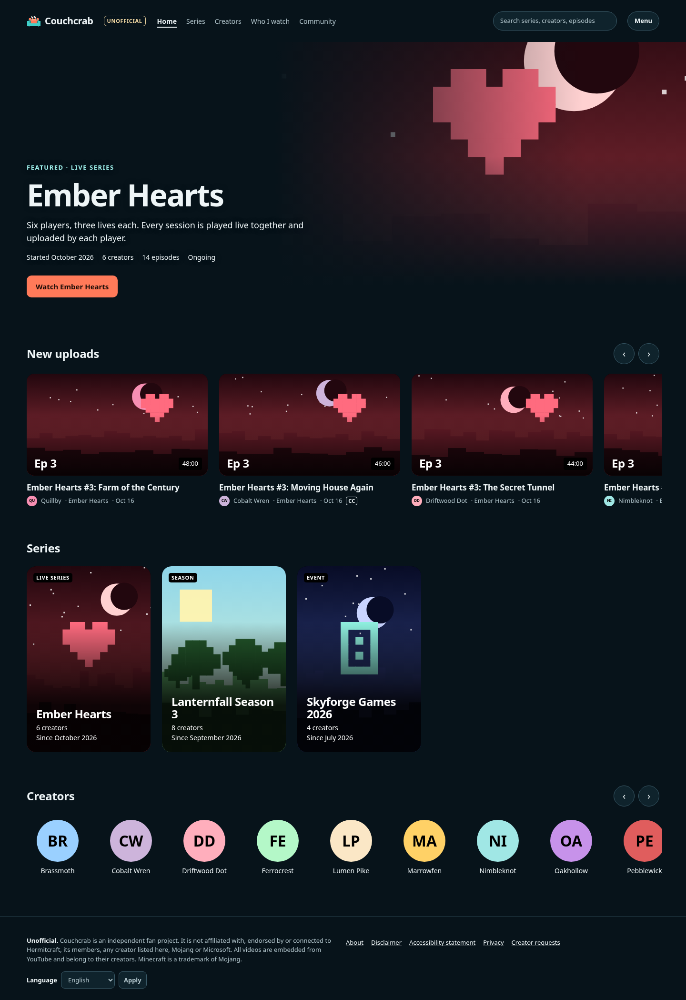
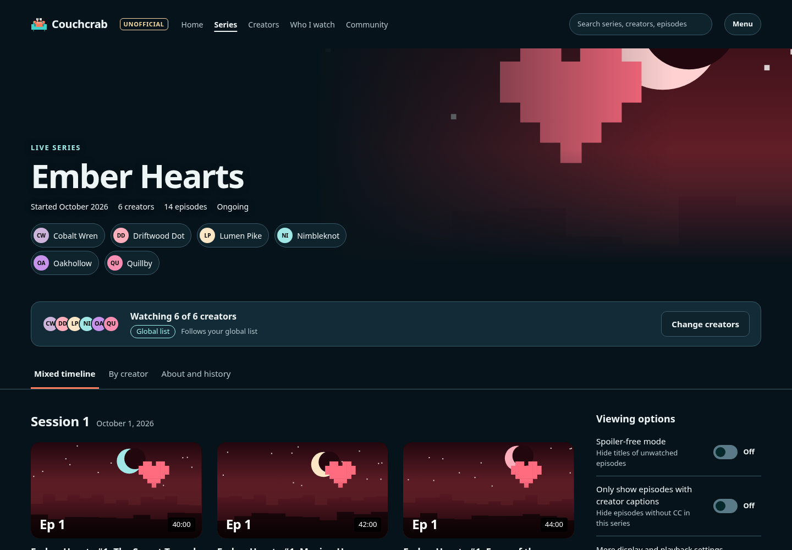
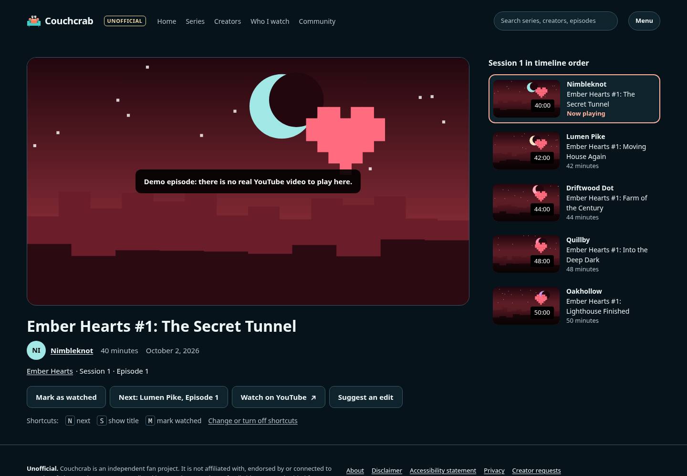
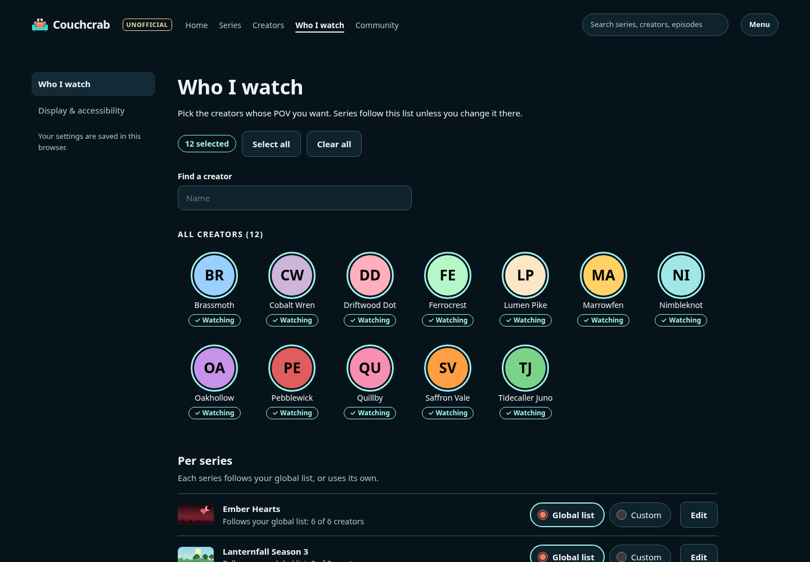
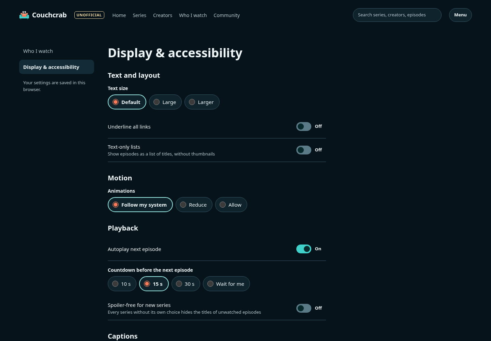
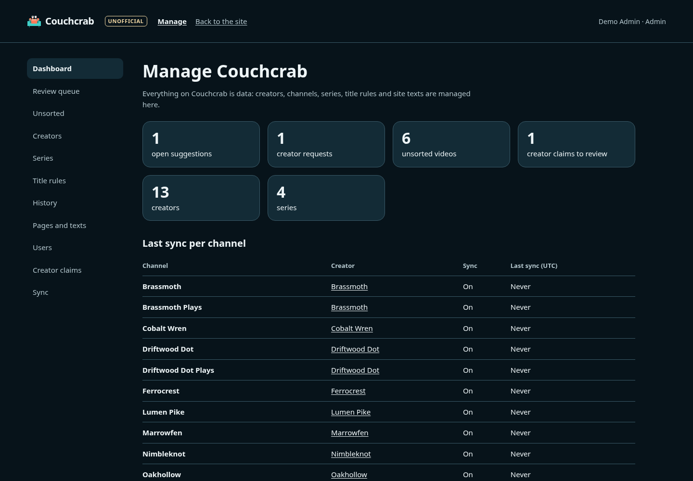
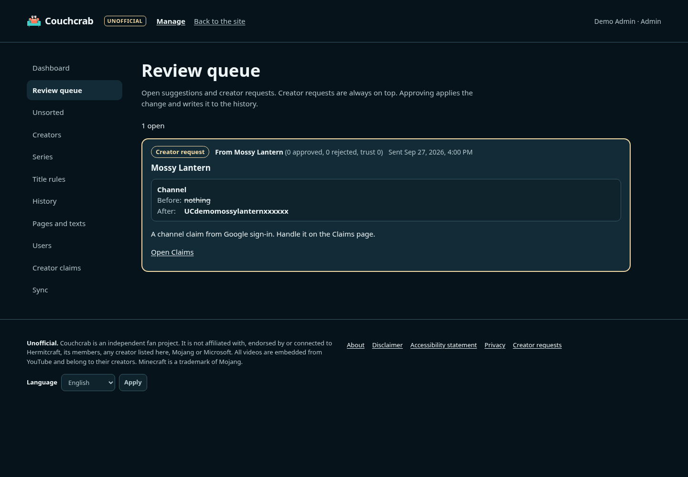
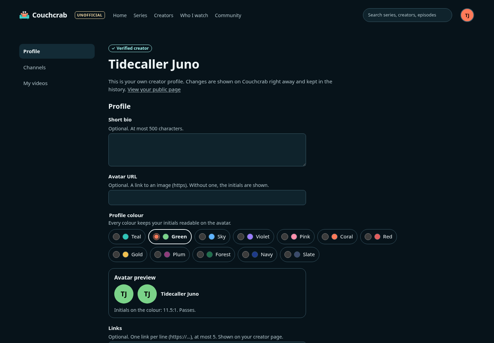
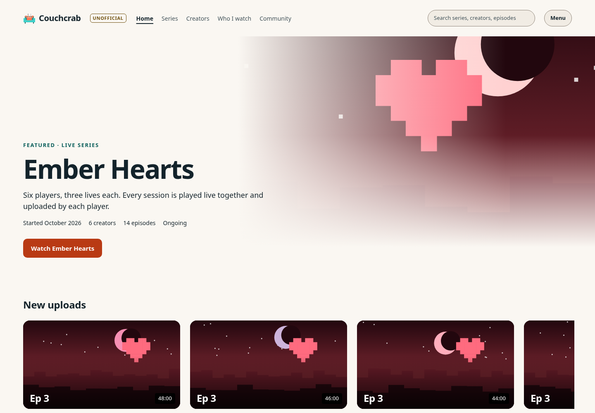

<p align="center">
  
</p>

<h1 align="center">Couchcrab</h1>

<p align="center">
  <strong>Binge Minecraft YouTube series from every point of view, in the order it happened.</strong><br>
  A community-run, open-source fan project.
</p>

<p align="center">
  <a href="LICENSE"></a>
  
  <a href="CONTRIBUTING.md"></a>
</p>

> [!IMPORTANT]
> **Couchcrab is an unofficial fan project.** It is not affiliated with, endorsed by or connected to Hermitcraft, its members, any creator listed on the site, Mojang or Microsoft. Every video plays from YouTube on the creator's own channel, so views, ads and revenue stay with the creator. Couchcrab never downloads, re-hosts or monetises videos.



<sub>Screenshots show the built-in demo data: every creator and series in them is fictional.</sub>

## What is Couchcrab?

Multiplayer Minecraft series like a Hermitcraft season or a Life series are told by a dozen creators at once, each on their own channel. Following the story means juggling channels, playlists and upload dates. Couchcrab puts it all in one place, Netflix-style:

- **Series, not channels.** Every season, Life series and event is a series with its own poster, page and timeline.
- **Pick who you watch.** Choose your creators once. Each series can follow that list or use its own.
- **Mixed timeline.** Watch your chosen points of view (POVs) in upload order, week by week, or session by session for live series.
- **Continue watching.** Progress is saved, the next episode on your timeline plays when you're ready.
- **Spoiler-free mode.** Per series: titles and thumbnails of unwatched episodes stay hidden.
- **Extras.** Livestream VODs live in a side series next to the main one.
- **Community-maintained.** Creators, channels, series, sessions and the rules that sort uploads are all managed in the app. Anyone can suggest an edit, editors review them, everything has a history and can be reverted. Creators can file a request that always goes to the top of the queue. The Community page explains how to help and lists the recent changes.
- **Search.** Find series, creators and episodes from the header, without spoiling titles you chose to hide.
- **Works without an account.** Preferences and progress live in your browser. Sign in with Discord to sync them and to suggest edits.

## Accessibility

Accessibility is a requirement, not a nice-to-have. We target **WCAG 2.2 level AA** in every theme.

- Dark, light and high-contrast themes, text size settings, reduced motion, underlined links, text-only lists.
- A **CC badge** for episodes with creator-made captions (not just auto-generated ones), and a filter to show only those.
- Autoplay is a setting with a countdown you can pause, cancel or turn into "wait for me".
- Full keyboard support, visible focus, skip links, single-key shortcuts that can be turned off.
- State is never shown by colour alone.

Every pull request that touches the UI is checked with axe and keyboard tests. See [docs/ACCESSIBILITY.md](docs/ACCESSIBILITY.md).

## Translations

Couchcrab is built to be translated. Every interface string lives in a message file, dates and numbers use the visitor's locale, and community content (series descriptions, site pages) can be translated in the app. English is the source language. Want Couchcrab in your language? See [Translating](CONTRIBUTING.md#translating).

## Status

The first version is **feature complete** and runs locally with demo data, but it is **not online yet**. Next steps: production hosting, the Google OAuth verification that creator claims need, and seeding the real series (by the community, in the app).

## Screenshots

| | |
| --- | --- |
|  |  |
| Series page with the mixed timeline | Watch page with the session queue |
|  |  |
| Who I watch | Display and accessibility settings |
|  |  |
| Management tool | Review queue |
|  |  |
| Creator dashboard | Light theme |

More in [docs/screenshots](docs/screenshots).

## Tech stack

| Part | Choice |
| --- | --- |
| App | [SvelteKit](https://svelte.dev/docs/kit) (Svelte 5, TypeScript) |
| Database | SQLite with [Drizzle ORM](https://orm.drizzle.team) |
| Translations | [Paraglide JS](https://inlang.com/m/gerre34r/library-inlang-paraglideJs) |
| Login | Discord OAuth (viewers and editors), Google OAuth (creators), server-side sessions |
| Video data | YouTube Data API v3, playback through the YouTube IFrame Player |
| Tests | Vitest, Playwright with axe-core |

## Getting started

You need **Node.js 22** or newer.

```bash
git clone https://github.com/kzenmatthias/couchcrab.git
cd couchcrab
npm install
cp .env.example .env
npm run db:migrate
npm run db:seed      # demo data, no API keys needed
npm run dev
```

Open http://localhost:5173. The demo data lets you work on the whole app without a YouTube or Discord key.

### Optional keys

Everything works without keys: the sign-in buttons are then disabled with a short explanation, and the demo data needs no API. Put keys in `.env` (never commit it).

| Variable | What for |
| --- | --- |
| `YOUTUBE_API_KEY` | Syncing real uploads (`npm run sync`). Free key from the [Google Cloud console](https://console.cloud.google.com/apis/library/youtube.googleapis.com). |
| `DISCORD_CLIENT_ID`, `DISCORD_CLIENT_SECRET` | Sign in with Discord (viewers and editors). |
| `GOOGLE_CLIENT_ID`, `GOOGLE_CLIENT_SECRET` | Creators claim their profile by signing in with Google. |
| `ADMIN_DISCORD_IDS` | Comma-separated Discord user ids that get the admin role on every sign-in. |
| `PROMOTE_TRUST_THRESHOLD` | Trust (approved minus rejected suggestions) from which the user list marks a viewer with "Suggest promoting to editor". Default 10. |

Redirect URLs (use your own origin in production, e.g. `https://couchcrab.example`):

| Provider | Redirect URL |
| --- | --- |
| Discord | `http://localhost:5173/auth/discord/callback` |
| Google | `http://localhost:5173/auth/google/callback` |

**Discord app**

1. Open the [Discord developer portal](https://discord.com/developers/applications) and create a new application.
2. Under **OAuth2**, copy the **Client ID** and reset/copy the **Client Secret** into `DISCORD_CLIENT_ID` and `DISCORD_CLIENT_SECRET`.
3. Add the redirect URL above under **Redirects** and save. Couchcrab only asks for the `identify` scope.
4. To make yourself admin, turn on Developer Mode in Discord, right-click your name, **Copy User ID**, and put it in `ADMIN_DISCORD_IDS`. You get the admin role on your next sign-in.

**Google OAuth client**

1. In the [Google Cloud console](https://console.cloud.google.com/), create (or pick) a project and enable the **YouTube Data API v3**.
2. Under **Google Auth Platform** (OAuth consent screen), set up an **External** app in **Testing** mode. Add the scopes `openid` and `https://www.googleapis.com/auth/youtube.readonly`.
3. Add the Google accounts you test with under **Test users**. Only those accounts can sign in while the app is in testing. `youtube.readonly` is a sensitive scope, so a public deployment needs Google's OAuth verification.
4. Under **Clients** (Credentials), create an **OAuth client ID** of type **Web application** and add the redirect URL above under **Authorized redirect URIs**.
5. Copy the client id and secret into `GOOGLE_CLIENT_ID` and `GOOGLE_CLIENT_SECRET`.

Couchcrab uses the Google access token once, to ask YouTube which channels the account owns (`channels.list?mine=true`), and then drops it. It keeps the Google account id and the ids and names of claimed channels, never the token.

### Becoming admin locally

The management tool lives at `/manage`. Editors manage creators, channels, series, title rules and the Unsorted queue; admins also manage users and roles, the site pages and texts, creator claims and the sync. There are three ways in:

- **Discord:** put your Discord user id in `ADMIN_DISCORD_IDS` (see above). Every sign-in with that id gets the admin role.
- **Any account:** sign in once, then run `npm run make-admin -- <user id>`. Admins see the ids on `/manage/users`; on a fresh install, look the id up with `npm run db:studio`.
- **Demo data:** `npm run db:seed` adds the fictional users "Demo Editor" and "Demo Admin". They have fake Discord ids, so you can't sign in as them; the e2e tests use them by writing a session row directly.

Promote others to editor or admin on `/manage/users`. The last admin can't be demoted.

### Starter catalog

A fresh install has no creators or series. Instead of typing them all into `/manage`, you can load a starter catalog once from a JSON file: creators with their YouTube channels, series with their participants, descriptions, sessions and title rules. The sync then fills in the episodes.

```sh
npm run catalog:import -- catalog.json --dry-run   # check the file and show what would change
npm run catalog:import -- catalog.json             # write it, all in one transaction
npm run sync -- --first-max 20000                  # first sync: each channel's whole upload history
```

The repo ships one: [`catalog/hermitcraft-and-friends.json`](catalog/hermitcraft-and-friends.json), with every Hermitcraft season (1 to 11), the Life series, the April Fools specials, Empires SMP seasons 1 and 2, and the X Life, Afterlife, New Life, Vampires, Misadventures, Festivale and Pantheon SMPs: 105 creators, 133 channels and the title rules that sort their uploads. Channel ids and season dates come from public sources and the channels' own upload lists. Fixes are welcome, in the file or in the app.

```sh
npm run catalog:import -- catalog/hermitcraft-and-friends.json
```

The import is meant as a one-off. Afterwards the management tool is the source of truth: running the import again is safe (an unchanged file changes nothing, an edited file updates the fields it lists), but it never deletes anything, never changes a claimed creator's profile (it only adds new channels) and leaves opted-out creators alone. Every change goes through the same validation as an edit in the app and shows up in the history (actor "Sync"). The whole file is checked first and every problem is listed; if anything fails, nothing is written.

```json
{
  "creators": [
    {
      "slug": "example-creator",
      "name": "Example Creator",
      "color": "#2ec4b6",
      "channels": [{ "youtubeChannelId": "UC...", "title": "Example Creator", "kind": "main" }]
    }
  ],
  "series": [
    {
      "slug": "example-life",
      "title": "Example Life",
      "kind": "live_series",
      "status": "ongoing",
      "grouping": "session",
      "startedAt": "2026-01-05",
      "endedAt": null,
      "creators": ["example-creator"],
      "description_en": "...",
      "description_nl": "...",
      "extras": true,
      "sessions": [{ "number": 1, "startsAt": "2026-01-05", "title": null }],
      "rules": [
        { "pattern": "Example Life", "match": "contains", "target": "main", "channel": null, "priority": 0 }
      ]
    }
  ]
}
```

- Creators match by `slug` (or, for an unknown slug, by one of their channels); channels by `youtubeChannelId`; series by `slug`; sessions by `number`; rules by `pattern`, `match` and `channel`.
- `color` is optional: a new creator without one gets a profile colour picked from the slug. A series without `poster` (`{ "palette", "seed", "motif" }` or `{ "url" }`) gets generated art with a palette and seed picked from the slug. Fields left out (`color`, `poster`, a channel `title`, a session `title`, `description_nl`) keep their stored value on a known row.
- `extras: true` creates the Extras child series (as "Create Extras series" in the app). Sessions are also added to an Extras child grouped by session, where the livestreams go.
- `sessions` need `"grouping": "session"`. Each session ends where the next one starts; the last stays open while the series runs and ends at `endedAt` once it has ended.
- A rule's `channel` is a creator slug (the rule only applies to that creator's main channel) or a YouTube channel id `UC...` (exactly that channel, which must belong to one of the series' creators). `null` means every channel of the series' creators. `enabled` is optional. `"withinSeriesDates": true` limits the rule to uploads from 2 days before the series starts up to 7 days after it ends, for creators who never number their seasons.

### Useful commands

| Command | Does |
| --- | --- |
| `npm run dev` | Development server |
| `npm run check` | Type and Svelte checks |
| `npm run lint` / `npm run format` | ESLint and Prettier |
| `npm test` | Unit tests |
| `npm run test:e2e` | Browser tests, including accessibility checks |
| `npm run db:migrate` / `npm run db:seed` | Database setup and demo data |
| `npm run make-admin -- <user id>` | Give a user the admin role |
| `npm run catalog:import -- <file> [--dry-run]` | Load a starter catalog from a JSON file (see "Starter catalog") |
| `npm run sync` | Fetch new uploads from YouTube, sort them with the title rules and refresh stored data older than 25 days. Flags (after `--`): `--channel <youtube id>`, `--dry-run`, `--refresh-only`, `--first-max <n>` (how many uploads a channel's first sync takes, 200 by default). Needs `YOUTUBE_API_KEY`; without it, it exits with a note |

## Documentation

- [docs/SPEC.md](docs/SPEC.md): what Couchcrab does and the decisions behind it
- [docs/ARCHITECTURE.md](docs/ARCHITECTURE.md): data model, sync, auth, translations
- [docs/ACCESSIBILITY.md](docs/ACCESSIBILITY.md): our accessibility rules and how we test
- [docs/design](docs/design): the clickable design board and screenshots

## Contributing

Code, translations, bug reports, design feedback and data fixes are all welcome. Start with [CONTRIBUTING.md](CONTRIBUTING.md). Fixing a video in the wrong season doesn't need code: use "Suggest an edit" on the site.

Please follow our [Code of Conduct](CODE_OF_CONDUCT.md).

## For creators

Are you a creator and want something corrected or removed? Use the "Creator requests" form on the site, or open an issue. Creator requests are always handled first. You can also claim your creator profile by signing in with Google: once Couchcrab sees you own the channel, you get a "Verified creator" badge and can manage your own profile and videos.

## License

Couchcrab is free software under the [GNU Affero General Public License v3.0](LICENSE). You may use, change and share it. If you run a modified version as a website, you must share your source code with its users too.

Videos, thumbnails, names and channel art belong to their creators. Minecraft is a trademark of Mojang Synergies AB.
